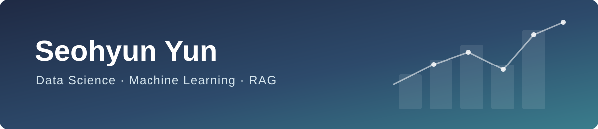

<h1>Hello, My name is Seohyun Yun</h1>

Data Science student interested in Machine Learning and LLM-based data analysis.

<h2>💁🏻‍♀️ About Me</h2>
<ul>
<li>🎓 Undergraduate in Data Science at Seoul Women's University  </li>
<li>🌎 Exchange student at California State University, Long Beach (2026)
<ul>
<li>🇰🇷🇺🇸 Participant, KORUS 70 Korea-U.S. Advanced Technology Scholars Program (2026)</li>
</ul>
 </li>
<li>🔍 Interested in Machine Learning, RAG, and data analysis &amp; visualization  </li>
<li>📊 Experienced in ML and DL projects: object detection, battery SOC prediction, news Q&amp;A  </li>
<li>🤝 President of DSOB, a data science club (2024–2025)</li>
</ul>

<h2>🛠️ Tech Stack</h2>

<b>Languages</b> 

<b>ML / DL / Data</b> 

<b>Visualization</b> 

<b>APIs</b> 

<b>Tools</b> 

<h2>🗂️ Projects</h2>
<ul>
<li>📰 <b>[2026.07 – ] AI News Q&amp;A Service</b> 
RAG-based news Q&amp;A with LangChain and FAISS  </li>
<li>🛩️ <b>[2025.12] KAI Special Award</b> at 2025 공군사관학교 미래 항공우주 학술대회 
UAV real-time object detection with YOLOv8, benchmarking 6 image preprocessing methods  </li>
<li>🔋 <b>[2025.09] Excellence Award</b>  at 2025 산업안전 상생 논문 경진대회 
Li-ion battery SOC prediction with XGBoost and SHAP interpretation  </li>
<li>🌐 <b>[2025.06] 에티코드 (Ethicode)</b> · AI bias quiz for an AI ethics campaign 
Deployed on GitHub Pages, 249 participants  </li>
<li>🥬 <b>[2024.11] Foreign object detection in dried seaweed (gim)</b> 
Object detection with Faster R-CNN and ResNet</li>
</ul>

<h2>🥇 Awards</h2>
<ul>
<li><b>2025.12</b> KAI Special Award, 2025 Korea Air Force Academy Future Aerospace Conference  </li>
<li><b>2025.09</b> Excellence Award (Student Category), 2025 Industrial Safety Win-Win Paper Contest  </li>
<li><b>2023</b> Encouragement Award, GURU Hackathon (Python/HTML)</li>
</ul>

<h2>📫 Contact</h2>

ssshyun1001@swu.ac.kr

